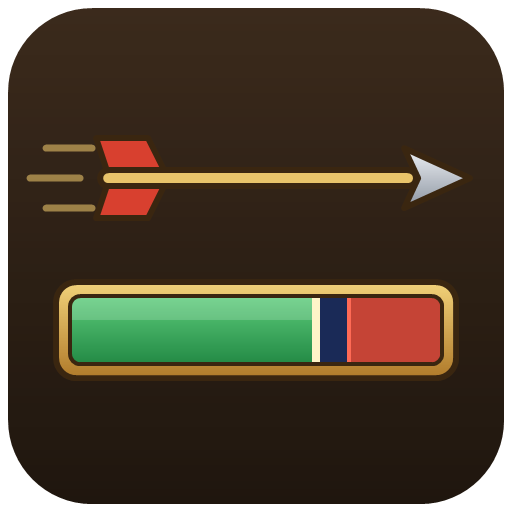

<p align="center"></p>

# Vanilla Ranged Swing Zone

An addon for WoW Forever (the `_forever_` client, 1.60.x) that marks, on
Blizzard's own Swing Timer, the moment to stop moving so your next Auto Shot
goes off.

- **The ranged bar turns red before each shot.** Auto Shot aims for the last
  half second of each ranged swing, and only while you stand still: if you
  are moving, the shot waits. During that half second the fill of the
  Swing Timer's Ranged bar turns red, so you know when to stop.
- **The zone shows it coming.** The end of the bar, where the fill will turn
  red, is tinted red too, under the fill, so you see the moment approach
  before it arrives. It is as wide as that half second is of the swing.
- **Blizzard's bar, unchanged otherwise.** Edit Mode still places, sizes and
  hides the bar, the zone follows it, and the fill keeps its texture, only
  recolored.
- **Adjustable.** How long before the shot the fill changes color (0.1 to
  1.5 seconds, 0.5 by default), the color, and whether to tint the zone and
  how strongly (40% by default).
- **Every client language.** The texts are in English, German, Spanish (EU
  and Latin America), French, Italian, Korean, Portuguese (Brazil, also used
  by Portugal's client), Russian and Chinese (simplified and traditional).

## Installing

1. Copy the `VanillaRangedSwingZone` folder into
   `World of Warcraft\_forever_\Interface\AddOns\`.
2. Turn on Blizzard's Swing Timer if it is off: Options > Advanced Options >
   Swing Timer. The options page of this addon says so when it is off.
3. The options are under the game menu: Options > AddOns > Vanilla Ranged
   Swing Zone (or `/vrsz`).

The settings are shared by all the characters of your account. The game
saves them in `VanillaRangedSwingZoneDB`.

## Commands

| Command | What it does |
|---|---|
| `/vrsz` | Open the options |
| `/vrsz reset` | Restore the default settings |

`/vanillarangedswingzone` works as well as `/vrsz`.

## How it works

WoW Forever ships its own swing timer (`Blizzard_SwingTimer`). Its Ranged bar,
`SwingTimerRangedFrame`, fills from empty to full between one shot and the
next: Blizzard starts it with `ResetSwingTimer(duration)` when a shot goes
off, and empties it with `ClearSwingTimer()` when the time is up, the weapon
changes or the bar hides. The addon hooks both with `hooksecurefunc`, which
leaves Blizzard's code untouched, times the same swing, and during its last
moments desaturates the fill and tints it with the chosen color. While the
bar is empty nothing runs.

The zone is a texture on the bar's right end, drawn just under the fill, as
wide as the windup is of the running swing (or of the ranged weapon's speed
while the bar is empty). It is laid out again when a swing starts or ends,
when Edit Mode resizes the bar, when the bar shows, and when the weapon's
speed changes.

## Files

| File | Purpose |
|---|---|
| `Locales\` | Translations, one file per language; the English text is the key |
| `Core.lua` | Settings, shared helpers, startup, slash commands |
| `Zone.lua` | Follows Blizzard's ranged bar, draws the zone and recolors the fill |
| `Options.lua` | The settings page |
| `Tests\` | Offline tests (not loaded by the game) |
| `.github\logo.png` | The project logo (not part of the addon) |
| `CHANGELOG.md` | Release notes, shown on CurseForge for each file |
| `.pkgmeta` | How CurseForge packages a release |

## Tests

The tests run the real addon files, loaded in the order of the TOC, against
a strict stand-in for the WoW Forever API that includes Blizzard's ranged
swing bar, cut down from its source, and a virtual clock. They need a Lua 5.1
interpreter, the game's Lua:

```
lua5.1 Tests\run.lua [path to VanillaRangedSwingZone]
```

The path defaults to the folder that holds `Tests`. The tests shoot swings of
several lengths and check when the fill turns red and back, and the zone's
width, color and layer, with durations Blizzard ignores, secret ones, a bar
that hides, is resized or loads after login, a weapon whose speed changes,
settings changed in the middle of a swing, and a game that runs the
addon's timing once more in the frame Blizzard's bar empties; they cover the
options page, the slash commands, the saved settings, and every client
language, which must translate exactly the texts the code uses, with the same
placeholders. They also fail if the addon sets a global other than its saved
settings and slash commands.

## Releasing

CurseForge packages every tagged commit pushed to this repository.

1. Raise `## Version` in `VanillaRangedSwingZone.toc` and add that version's
   entry at the top of `CHANGELOG.md`. The tests check that both match.
2. Commit, tag the commit `v<version>` and push the tag:
   `git push origin v<version>`. A tag containing `beta` or `alpha` makes a
   beta or alpha file instead of a release.
3. CurseForge builds the zip as `.pkgmeta` says: the `VanillaRangedSwingZone`
   folder without the tests, with `CHANGELOG.md` as the file's changelog.

## License

MIT, see [LICENSE](LICENSE).
